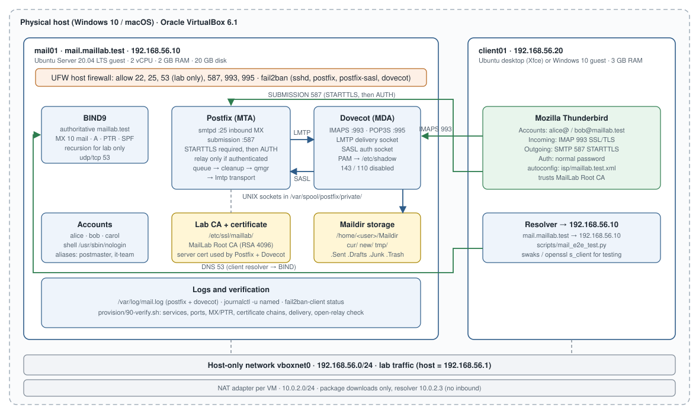
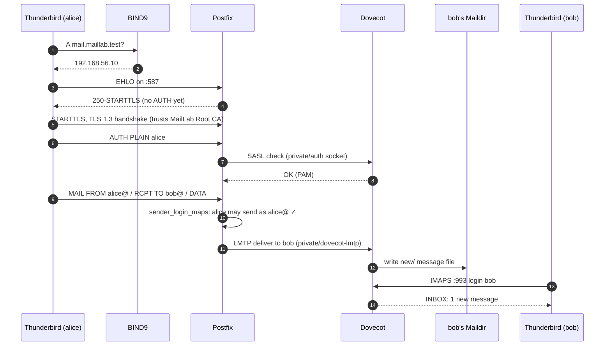

# Email Server Lab: Postfix + Dovecot + Thunderbird on VirtualBox

**A complete, self-contained email system built in a virtual lab.** A Linux guest runs the mail server
(SMTP, IMAP, POP3, DNS, TLS), and a second guest runs Mozilla Thunderbird as the mail client. The build follows
a written step-by-step procedure, and every step has a verification check.

> **Provenance.** This was a lab project in my Computer Systems Technician (Network Systems) diploma
> at Mohawk College, 2021. A guest OS in VirtualBox hosted the mail server, and Thunderbird on a second guest
> was the client, built by following a structured lab procedure. In 2026 I rewrote the documentation for this
> portfolio and turned the procedure into repeatable scripts (Vagrant + shell), configuration files and tests.
> Everything uses the reserved `maillab.test` domain and a private host-only network. No real domains,
> accounts or passwords are included.



## What it does

| Capability | How |
|---|---|
| Receive mail for `@maillab.test` | Postfix on port 25, found through the domain's **MX** record |
| Send mail from a client | Postfix **submission on 587**: STARTTLS is required, then SMTP AUTH |
| Read mail | Dovecot **IMAPS 993** and **POP3S 995** (plain-text 143/110 turned off) |
| Store mail | Dovecot **LMTP** delivers into each user's **Maildir** |
| Authenticate | Dovecot checks passwords through PAM and answers Postfix SASL requests over a UNIX socket |
| Name resolution | **BIND9** authoritative for `maillab.test` (MX, A, PTR, SPF, DMARC) and a lab-only resolver |
| Encryption | Private **lab CA** issues the server certificate (SAN for mail/imap/smtp); TLS 1.2+ only |
| Abuse protection | Not an open relay, sender-login matching, rate limits, VRFY disabled, UFW, fail2ban |
| Client | **Thunderbird** set up automatically from an ISPDB autoconfig file |

## Mail flow



## Quick start

Requires VirtualBox 6.1+ and Vagrant 2.2+ on the host.

```bash
vagrant up mail01                 # builds and verifies the server (about 5 minutes)
vagrant up client01               # optional: desktop VM with Thunderbird (GUI window)
cat out/maillab-credentials.txt   # random per-build passwords for alice, bob, carol

# End-to-end test from the host (add "192.168.56.10 mail.maillab.test" to the hosts file first)
python3 scripts/mail_e2e_test.py --ca out/maillab-ca.crt \
    --sender alice --sender-pass '<from file>' --rcpt bob --rcpt-pass '<from file>'
```

The last provisioning step (`provision/90-verify.sh`) checks that services are running, the right ports are open (and plain-text ports are closed),
MX/PTR records resolve, both TLS certificate chains verify, local delivery reached a Maildir, and an open-relay attempt is refused.

## Documentation

| # | Document | Contents |
|---|---|---|
| 01 | [Requirements and scope](docs/01-requirements.md) | Objectives, lab constraints, success criteria |
| 02 | [Architecture](docs/02-architecture.md) | Components, protocols and ports, mail flow, design choices |
| 03 | [Virtual environment](docs/03-virtual-environment.md) | Host, VirtualBox networking (host-only + NAT), VM specs |
| 04 | [Build procedure](docs/04-build-procedure.md) | Step-by-step procedure with a check after every step (manual equivalent of the scripts) |
| 05 | [DNS design](docs/05-dns.md) | Zones, MX/A/PTR/SPF/DMARC, why each record matters |
| 06 | [Security](docs/06-security.md) | TLS, authentication, relay control, firewall, fail2ban, threat table |
| 07 | [Thunderbird client](docs/07-thunderbird-client.md) | Automatic and manual account setup, CA import, folders |
| 08 | [Testing](docs/08-testing.md) | Test cases with commands and expected results |
| 09 | [Troubleshooting](docs/09-troubleshooting.md) | Logs, common errors and fixes |
| 10 | [Lessons learned](docs/10-lessons-learned.md) | What the project taught and what I would do differently now |

## Repository layout

```
Vagrantfile                     Two VirtualBox guests: mail01 (server) and client01 (Thunderbird)
provision/00-common.sh          Hostname, time, packages, debconf answers
provision/10-dns.sh             BIND9 zones + resolver, syntax-checked with named-checkzone
provision/20-tls.sh             Lab root CA + SAN server certificate
provision/30-postfix.sh         Postfix, aliases, sender-login map
provision/40-dovecot.sh         Dovecot IMAPS/POP3S, LMTP, SASL
provision/50-users.sh           Mailbox users (nologin, random passwords), welcome mail
provision/60-hardening.sh       UFW, fail2ban, unattended upgrades
provision/90-verify.sh          Server-side smoke tests
provision/client.sh             Desktop + Thunderbird + autoconfig + CA trust
config/                         Every config file installed on the server (Postfix, Dovecot, BIND, fail2ban, Thunderbird)
scripts/mail_e2e_test.py        Client-side end-to-end test (submit → deliver → IMAP fetch → negative tests)
tests/test_configs.py           Policy tests on the configs (no open relay, TLS-only, sockets match...)
.github/workflows/ci.yml        Unit tests, ShellCheck, named-checkzone, postconf syntax check
```

## Related

The [network design project](https://github.com/arththakkar186/network-design-it-company) puts a mail server (`MAIL01`, 10.10.50.40) in its server VLAN and publishes only TCP/25 to it through the edge firewall. This lab is how that server is built.

## Skills shown

Linux server administration · SMTP/ESMTP, IMAP, POP3, LMTP · Postfix and Dovecot · DNS (BIND9, MX, PTR, SPF, DMARC) · PKI and TLS (private CA, SAN certificates) · SASL authentication · anti-relay and anti-abuse controls · host firewall and fail2ban · VirtualBox networking · infrastructure as code (Vagrant, shell) · test automation (Python, swaks, openssl)
