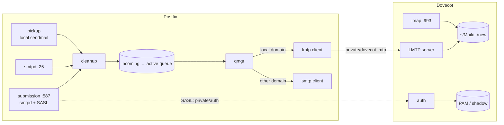

# 02 · Architecture

## Components

| Component | Software | Version (Ubuntu 20.04) | Purpose |
|---|---|---|---|
| Hypervisor | Oracle VirtualBox | 6.1 | Runs both guests on one physical host |
| Server OS | Ubuntu Server LTS | 20.04 | Stable, five-year support, well documented |
| DNS | BIND9 | 9.16 | Authoritative for `maillab.test`, lab resolver |
| MTA/MSA | Postfix | 3.4 | SMTP receive (25), authenticated submission (587), queueing |
| MDA/IMAP/POP3 | Dovecot | 2.3 | LMTP delivery, IMAPS, POP3S, SASL auth for Postfix |
| PKI | OpenSSL | 1.1.1 | Lab root CA and server certificate |
| Firewall | UFW (iptables) | | Allow only mail, DNS and SSH ports |
| Brute-force protection | fail2ban | 0.11 | Ban IPs after repeated auth failures |
| Client | Mozilla Thunderbird | 78 | IMAP + SMTP mail client |

## Ports and protocols

| Port | Protocol | Service | Encryption | Who connects |
|---:|---|---|---|---|
| 25 | SMTP | Postfix `smtpd` | Opportunistic STARTTLS | Other mail servers (MX delivery) |
| 587 | SMTP submission | Postfix `submission` | **STARTTLS required before AUTH** | Thunderbird sending |
| 993 | IMAPS | Dovecot | Implicit TLS | Thunderbird reading |
| 995 | POP3S | Dovecot | Implicit TLS | Optional POP3 clients |
| 53 | DNS | BIND9 | | Lab clients (UFW limits to 192.168.56.0/24) |
| 22 | SSH | OpenSSH | SSH | Administrator / Vagrant |
| 110, 143 | POP3, IMAP plain text | **Disabled** | | |

## Internal message path

1. **Submission**: Thunderbird connects to 587. Postfix advertises STARTTLS but **not** AUTH until TLS is up (`smtpd_tls_auth_only = yes`).
2. **Authentication**: Postfix passes the credentials to Dovecot over the `private/auth` UNIX socket. Dovecot checks them through PAM. There is only one user database for SMTP and IMAP.
3. **Policy**: `reject_sender_login_mismatch` checks that the logged-in user owns the `MAIL FROM` address (from `sender_login_maps`), so alice cannot send as bob.
4. **Queue**: `cleanup` adds missing headers and the message ID, and writes the message to the queue. `qmgr` schedules delivery.
5. **Routing**: the recipient domain is in `mydestination`, so the message is local. `mailbox_transport` sends it to Dovecot over **LMTP**.
6. **Delivery**: Dovecot LMTP maps `bob@maillab.test` to the Unix user `bob` (`auth_username_format = %Ln`) and writes the file to `~bob/Maildir/new/`.
7. **Retrieval**: bob's Thunderbird connects to 993. Dovecot authenticates and lists new mail, and Thunderbird downloads it.

## Key design choices

| Decision | Alternative | Why this one |
|---|---|---|
| Postfix | Sendmail, Exim | Modular and secure by design (separate processes running with least privilege), clear config, Ubuntu default |
| Dovecot LMTP delivery | Postfix `local` writing to Maildir | Dovecot keeps its indexes in sync and quotas and Sieve filters become possible; Postfix never touches mailbox files |
| Dovecot SASL for Postfix | Cyrus SASL | One authentication backend for SMTP and IMAP; no separate saslauthd |
| Maildir | mbox | One file per message: no locking problems, safe with concurrent access, easy to back up |
| System (PAM) users | Virtual users in a database | Simplest option for a small lab; [10-lessons-learned](10-lessons-learned.md) covers moving to virtual users |
| Implicit TLS on 993/995, STARTTLS on 587 | Plain 143/110 with STARTTLS | Closing the plain-text ports removes any chance of a client logging in without encryption |
| Private lab CA | Self-signed server certificate | Clients trust one CA once, and certificates can be reissued without new warnings; it works the way a real PKI does |
| Host-only network | Bridged | Isolated from the campus/home LAN, with stable addresses |

## Capacity (lab scale)

| Resource | Allocation | Notes |
|---|---|---|
| CPU | 2 vCPU | Postfix and Dovecot are lightweight; 2 vCPU leave headroom for package upgrades |
| RAM | 2 GB | Under 300 MB used at idle with BIND, Postfix, Dovecot and fail2ban |
| Disk | 20 GB dynamic | Mail limit 25 MB per message (`message_size_limit`) |
